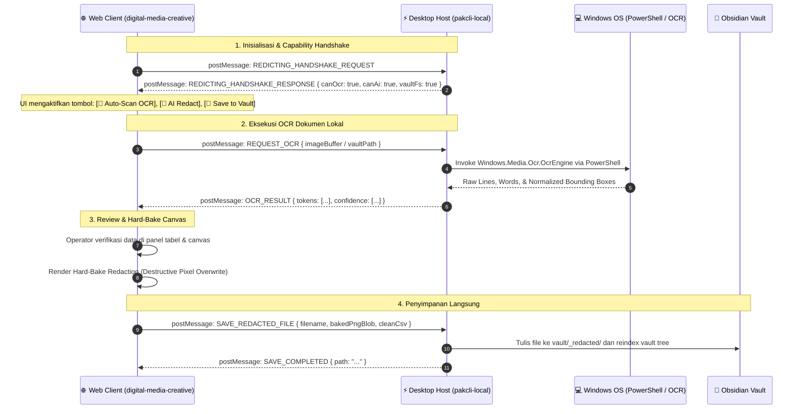

# 📌 Master Brief: Redicting — Universal AI Header-Driven Document Redactor & Hybrid Obsidian Bridge (pakcli-local)

> **Feature Status**: `0` (Draft / Pending Implementation)  
> **Target Module**: `local` (`pakcli-local`)  
> **Platform**: Windows Desktop / Electron (Host) + Web (Client)  
> **Date**: 2026-10-25  

---

## 1. Objective & Problem Statement

### Masalah (The Problem)
1. **Risiko Kebocoran PII (Privasi Dokumen)**: Mengunggah dokumen sensitif (struk transaksi, rekam medis, rekening koran, slip gaji) ke cloud untuk diproses OCR membawa risiko pelanggaran privasi berat (UU PDP No. 27/2022).
2. **Kerapuhan OCR Berbasis Template**: Struktur tabel struk dan invoice selalu bergeser. Template koordinat statis selalu gagal saat ada pergeseran margin atau baris baru.
3. **Dilema Arsitektur Web vs Desktop**:
   - Jika dibuat *hanya sebagai Web App*: Tidak bisa mengakses file vault lokal secara langsung, tidak punya akses ke Windows Native OCR, dan terbentur batasan sandbox browser.
   - Jika dibuat *hanya di dalam Plugin Desktop*: UI canvas interaktif yang kompleks harus ditulis ulang dan sulit dijadikan portofolio/alat mandiri yang bisa dicoba publik secara instan.

### Solusi (The Solution)
Membangun **Redicting** dengan arsitektur **Zero-Auth Static NPM-Style Distribution & Local-First Disk Cache**:
- **Front-end Web (`digital-media-creative`)**: Menggunakan multi-target build di folder `dist/`:
  1. `dist/index.html`: Website publik yang dibuka biasa di browser, berfungsi manual tanpa modul plugin.
  2. `dist/redicting-component.js`: Modul JS mandiri (ala NPM library / UMD `window.Redicting`), di-host di static CDN tanpa autentikasi (no auth, no token, pure static `GET`).
- **Host Bridge (`pakcli-local`)**:
  1. **Fetch Sekali & Simpan Lokal**: Mengunduh `redicting-component.js` sekali saja dan menyimpannya di disk vault sebagai `.obsidian/plugins/pakcli-local/cache/module-temporary.js`.
  2. **100% Offline-First**: Peluncuran berikutnya langsung membaca `module-temporary.js` dari disk lokal tanpa butuh koneksi internet sama sekali.
  3. **Injeksi Local Bridge**: `pakcli-local` meng-inject bridge lokal:
     - **Windows Native OCR (`Windows.Media.Ocr.OcrEngine`)** via PowerShell runner tanpa install binary pihak ketiga.
     - **AI Header-First Mass Redaction** (sensor otomatis seluruh baris di bawah kolom sensitif).
     - **Direct Vault Read/Write** (buka gambar dari vault dan simpan hasil *hard-bake* langsung ke folder `_redacted/`).

---

## 2. Arsitektur & Protokol Komunikasi (Progressive Handshake)

### 3-State Workflow Mode (Inherited from Prototype)
1. **Raw**: Tampilan gambar dokumen fisik apa adanya tanpa overlay kotak untuk pengecekan kasat mata.
2. **Edit**: Ruang kerja interaktif:
   - Stroke bounding box warna sesuai keyakinan OCR: 🟢 Hijau ($\ge 90\%$), 🟡 Kuning ($70-89\%$), 🔴 Merah ($<70\%$).
   - Garis putus-putus merah marun (`outline: 1.5px dashed`) untuk field sensitif (PII).
   - Sinkronisasi dua arah: Klik baris di tabel $\leftrightarrow$ Bounding box di canvas menyala.
3. **Final**: Preview hasil akhir sebelum ekspor, di mana teks sensitif diburamkan tebal / di-blackout permanen.

---

## 3. Rencana Implementasi & Struktur File

| File | Status | Deskripsi |
| :--- | :---: | :--- |
| `local/docs/brief-redicting-document-redactor-and-host-bridge.md` | ⏳ Status 0 | Master brief arsitektur dan spesifikasi fitur |
| `local/src/features/redicting/types.ts` | ⏳ Pending | Tipe data IPC handshake, schema token, kolom, dan baris tabel |
| `local/src/features/redicting/services/windowsOcr.ts` | ⏳ Pending | Service runner Windows Native OCR (`Windows.Media.Ocr`) via PowerShell |
| `local/src/features/redicting/services/bridgeHost.ts` | ⏳ Pending | Host listener `postMessage` RPC untuk mengelola komunikasi dengan web client |
| `local/src/features/redicting/ui/RedictingModal.ts` | ⏳ Pending | Modal Obsidian yang memuat iframe web client dengan injector bridge otomatis |
| `local/src/features/redicting/settings.ts` | ⏳ Pending | Pengaturan Redicting (URL web client lokal/remote, default redaction style, output folder) |
| `local/src/main.ts` | ⏳ Pending | Registrasi ribbon icon (`stamp`), command palette, dan file-menu context menu |

---

## 4. Keamanan & Hard-Bake Permanent Redaction (Security-First)

Untuk mematuhi prinsip keamanan standar tinggi:
1. **Bukan CSS Masking**: Hasil unduhan/simpan **bukan** gambar asli yang ditutupi elemen HTML `
` atau CSS filter.
2. **True Destructive Bake**: Fungsi `hardBake(canvas, boxes)` menggambar ulang pixel hitam pekat / noise acak langsung ke pixel buffer canvas (`CanvasRenderingContext2D.fillRect()`).
3. **Metadata Stripping**: Seluruh metadata sensitif (EXIF, camera metadata, GPS) dihapus saat canvas diekspor menjadi Blob PNG bersih.
4. **Data Bersih CSV/JSON**: Sel-sel yang ditandai sensitif otomatis digantikan dengan string literal `[REDACTED]`.

---

## 5. Acceptance Criteria Checklist

- [x] Status 0 brief dibuat dan di-commit ke `local/docs/`
- [ ] Schema data IPC Handshake & Bounding Box (`types.ts`) terdefinisi
- [ ] Runner PowerShell Windows Native OCR teruji dan menghasilkan bounding box yang akurat
- [ ] Host bridge `postMessage` terpasang di `pakcli-local`
- [ ] `RedictingModal` dapat memuat web client dan merespons handshake dengan sukses
- [ ] Context menu klik kanan pada gambar di Obsidian ("Redact Document with Redicting...") berfungsi
- [ ] Hard-bake pixel save ke vault terverifikasi aman dan tidak meninggalkan teks di inspect element
- [ ] TypeScript kompilasi `npm --prefix local run build` sukses 0 error dan ter-deploy ke vault
- [ ] Brief di-update ke Status 1
